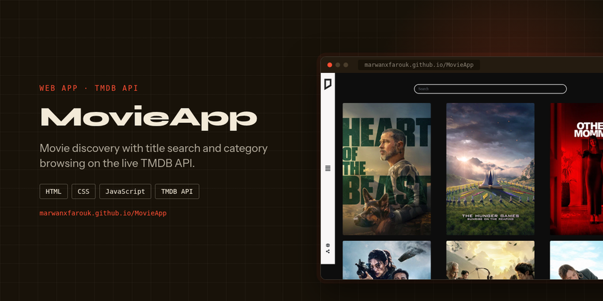
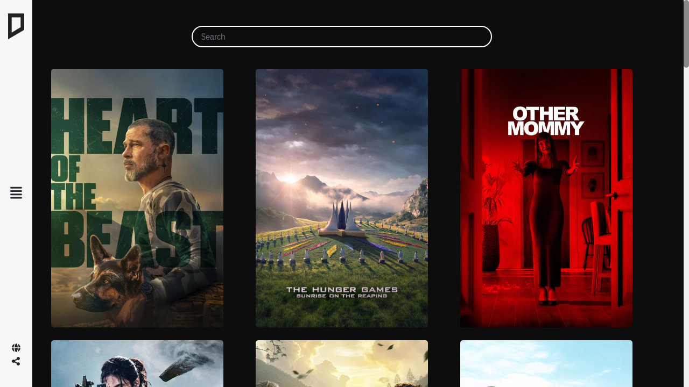

[](https://marwanxfarouk.github.io/MovieApp/)

# 🎬 MovieApp

A movie browsing app built with HTML, CSS, JavaScript, jQuery and Bootstrap, powered by the TMDB API. Browse now-playing, popular, top-rated, trending and upcoming movies, with live search by title.

## Demo

[Open the live demo](https://marwanxfarouk.github.io/MovieApp/)



## What it includes

- Now playing, popular, top rated, trending and upcoming movie lists from the TMDB API.
- Live search by movie title.
- Contact form with client-side validation.
- Reveal-on-scroll animations and a fully responsive layout.

### Stack

HTML5 · CSS3 · JavaScript (ES6+) · jQuery 3.7 · Bootstrap 5 · TMDB API · FontAwesome · Animate.css

### Code layout

- `index.html`: single-page markup (side navigation, movie grid, contact form).
- `assets/css/`: custom styles and media queries, plus vendored Bootstrap, FontAwesome and Animate.css.
- `assets/js/`: TMDB fetching, rendering, search and form validation, plus vendored jQuery and Bootstrap.
- `assets/images/`: logo.

## Run locally

```bash
git clone https://github.com/MarwanXFarouk/MovieApp.git
cd MovieApp
```

Open `index.html` in your browser. The app needs a free TMDB API key in `assets/js/index.js`.

## Notes

- Front-End project; all movie data comes from the TMDB API.
- This product uses the TMDB API but is not endorsed or certified by TMDB.

Built by [Marwan Farouk](https://github.com/MarwanXFarouk) · [LinkedIn](https://www.linkedin.com/in/marwanfarouk/)
